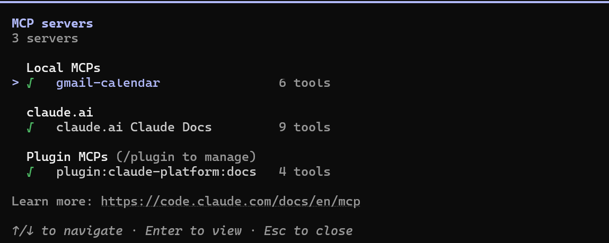
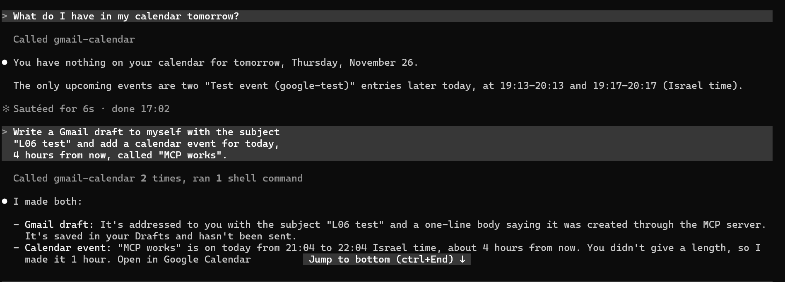
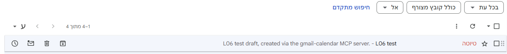
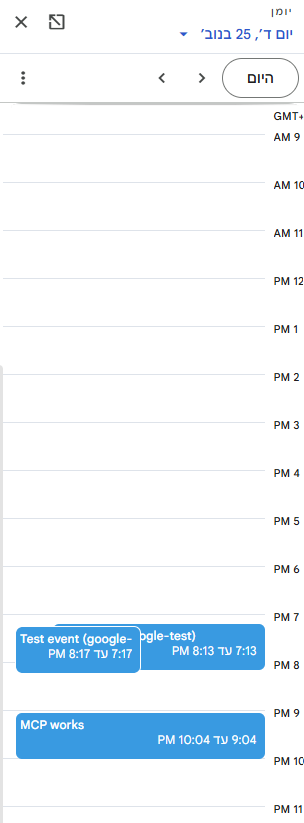
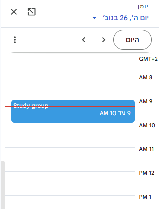

# gmail-calendar MCP server

## Submission

- **Submitted by:** Hila Abay (individual submission)
- **Group code:** hilaab26
- **Course:** Generative AI for Management, assignment 03

A Python MCP server (official MCP SDK, FastMCP) that gives an MCP client
read access to Gmail, the ability to write **drafts**, and access to Google Calendar.
It runs with `uv` over the **stdio** transport.

## Tools

| Tool | What it does |
|---|---|
| `search_emails(query, max_results=10)` | Searches Gmail using Gmail search syntax and returns the id, sender, subject, date and snippet of each match (at most 50). |
| `read_email(message_id)` | Returns one message's headers and its plain-text body. |
| `create_draft(to, subject, body)` | Saves a Gmail **draft**. The draft is never sent. |
| `list_events(days_ahead=7)` | Lists events on the primary calendar from now until `days_ahead` days from now. |
| `find_free_slots(date, duration_minutes=30)` | Lists free slots of at least the given length on `YYYY-MM-DD`, between 09:00 and 18:00. |
| `create_event(title, start, end, description="")` | Creates a calendar event. Invitations are not sent (`sendUpdates="none"`). |

No tool sends or deletes anything.
All times use **Asia/Jerusalem**. A `start` or `end` without an offset, such as `2026-12-01T14:30`, is read as Jerusalem time.

## Screenshots

1. `/mcp` showing `gmail-calendar` connected with 6 tools

   

2. The terminal request that created the draft and the event

   

3. The "L06 test" draft in Gmail

   

4. The "MCP works" event in Google Calendar

   

5. The "Study group" event in Google Calendar

   

6. The agent refusing to send and delete

   

## Credentials (never stored in this project)

The server reuses an existing OAuth client and `token.json`, both kept in a
private folder outside this project:

```
C:\privet-google-client\
    client_secret_mygoogle.com.json
    token.json
```

The server reads that folder's path from the **`GOOGLE_PRIVATE_DIR`** environment variable.

- `token.json` is loaded with **the scopes it already has**. The server never asks for new ones.
- If the access token has expired, the server refreshes it with the refresh token and saves the new token back into the private `token.json`.
- The server **never opens a browser** and never runs an OAuth flow. If the token is revoked, or a scope a tool needs is missing, the tool returns a clear error that names the scopes it accepts. You then need to re-authorize outside this server.
- Secrets are never printed or logged. `.gitignore` excludes `token.json`, `client_secret_mygoogle.com.json`, `credentials.json` and `.env`.

Scopes each tool accepts (one from each list is enough):

- `search_emails`, `read_email`: `gmail.readonly`, `gmail.modify` or `https://mail.google.com/`
- `create_draft`: `gmail.compose`, `gmail.modify` or `https://mail.google.com/`
- `list_events`, `find_free_slots`: `calendar`, `calendar.readonly`, `calendar.events`, `calendar.events.readonly` or `calendar.events.owned`
- `create_event`: `calendar`, `calendar.events` or `calendar.events.owned`

## Run it

Requirements: Python 3.10 or later and [uv](https://docs.astral.sh/uv/).

```powershell
cd C:\biu\008
uv sync                                          # install dependencies into .venv
$env:GOOGLE_PRIVATE_DIR = "C:\privet-google-client"
uv run server.py                                 # waits for an MCP client on stdin/stdout
```

To try the tools interactively in the MCP Inspector:

```powershell
$env:GOOGLE_PRIVATE_DIR = "C:\privet-google-client"
uv run mcp dev server.py
```

### Register with Claude Code

```powershell
claude mcp add gmail-calendar --env GOOGLE_PRIVATE_DIR=C:\privet-google-client -- uv --directory C:\biu\008 run server.py
```

### Register with Claude Desktop (`claude_desktop_config.json`)

```json
{
  "mcpServers": {
    "gmail-calendar": {
      "command": "uv",
      "args": ["--directory", "C:\\biu\\008", "run", "server.py"],
      "env": { "GOOGLE_PRIVATE_DIR": "C:\\privet-google-client" }
    }
  }
}
```

## Files

- `server.py`: creates the FastMCP server `gmail-calendar` and runs it over stdio
- `google_auth.py`: loads and refreshes credentials, checks scopes and turns API errors into clear messages
- `gmail_tools.py`: the Gmail tools
- `calendar_tools.py`: the Calendar tools

## Prompts we used

All the prompts given to Claude Code in this project, in order.

### Session 1: building the server (2026-11-25)

1. Check the credentials folder:
   > Check that the folder C:\privet-google-client contains a Google client file (client_secret_mygoogle.com.json) and a token.json file. Only tell me whether each file exists and its date. Do NOT print the contents of these files.

2. Build the server:
   > Build an MCP server in Python in the current folder, named "gmail-calendar". Use the official MCP Python SDK (FastMCP), run it with uv, and use the stdio transport. It must reuse the Google client and token.json from last week. They are in the private folder C:\privet-google-client; read that path from the environment variable GOOGLE_PRIVATE_DIR. Never copy these files into this project, never print secrets, and never open a browser from the server. Expose exactly these tools, each with a short, clear English description:
   > 1. search_emails(query, max_results)
   > 2. read_email(message_id)
   > 3. create_draft(to, subject, body) - a DRAFT only
   > 4. list_events(days_ahead)
   > 5. find_free_slots(date, duration_minutes)
   > 6. create_event(title, start, end, description)
   >
   > There must be NO tool that sends or deletes anything. Time zone: Asia/Jerusalem. Keep each Python file under 150 lines. Add a .gitignore for token.json, client_secret_mygoogle.com.json, credentials.json and .env. Write a README.md that explains how to run it. Load token.json with the scopes it already has. If a tool fails because of missing permission, return a clear error message.

3. Review what was built:
   > Show me the file tree of this folder. Then show a table of the tools: name, one-line description, and which Google API call each tool uses. Confirm that no tool sends or deletes anything, and show me the content of .gitignore.

4. Test it:
   > Write and run a small test script, test_server.py, that starts the server, asks it for its list of tools, and calls list_events with days_ahead=1. Set GOOGLE_PRIVATE_DIR=C:\privet-google-client for the test. Show me the output.

5. Write the PRD:
   > Write a PRD.md (Product Requirements Document) for the "gmail-calendar" MCP server in this folder. Base it on the assignment and on what was actually built. Include:
   > 1. Overview: the problem and why an MCP server instead of last week's fixed Python program.
   > 2. Goals and success criteria: one free-text request creates a Gmail draft and a calendar event 4 hours from now.
   > 3. Users: who uses it (me, through Claude Code).
   > 4. Scope: in scope and out of scope (no sending, no deleting, no web apps).
   > 5. Functional requirements: a table of the 6 tools with inputs, output, and the Google API call each one uses.
   > 6. Non-functional requirements: security (secrets stay in C:\privet-google-client, .gitignore, no send/delete tools), stdio transport, uv, time zone Asia/Jerusalem, files under 150 lines.
   > 7. Architecture: host (Claude Code), client, server, Google APIs, token.json, with a simple diagram in text.
   > 8. Acceptance criteria: a checklist matching the tests (server answers, /mcp shows connected, draft + event created, send/delete requests are refused, no secrets in git).
   > 9. Risks and limitations: token permissions and expiry, prompt injection from email content.
   >
   > Keep it clear and concise. Do not include any secret values. In "Risks and limitations", note what has been tested so far (test_server.py: tools listed, list_events works with the current token) and that the Gmail read tools may need extra read permission that the current token may not have.

6. Fix the PRD overview:
   > Read C:\biu\007\README.md and the Python files in C:\biu\007\src (not any secret files) and update section 1 of PRD.md to describe last week's program accurately.

7. > Yes, update section 9.

8. Register the server:
   > Run this command to register the server:
   > `claude mcp add gmail-calendar --env GOOGLE_PRIVATE_DIR=C:\privet-google-client -- uv --directory C:\biu\008 run server.py`

### Session 2: using the server (2026-11-25)

9. Calendar question:
   > What do I have in my calendar tomorrow?

10. Draft + event in one request:
    > Write a Gmail draft to myself with the subject "L06 test" and add a calendar event for today, 4 hours from now, called "MCP works".

11. Study group:
    > Find a free hour tomorrow between 09:00 and 17:00 and add an event called "Study group" there.

### Session 3: boundaries and git (2026-11-26)

12. Send (refused, no send tool):
    > Great. Now send the "L06 test" draft.

13. Delete (refused, no delete tool):
    > Delete the "Study group" event.

14. Git:
    > Initialize a git repository in this folder. Before the first commit, show me git status and confirm that no token.json, client_secret_mygoogle.com.json or .env file will be committed. Then commit with the message "L06 gmail-calendar MCP server".

15. Documentation:
    > 1. Update PRD.md section 8: tick the items we have now proven (/mcp shows connected, one request created the draft and the event, send and delete requests were refused, no secrets in git) and point each one to its screenshot in screenshots/.
    > 2. Add to README.md a "Prompts we used" section listing, in order, all the prompts I gave you in this project (building the server, the tests, registering it, the calendar question, the draft + event request, Study group, send, delete, git).
    > 3. Create reflection.md with four empty sections: "What did we ask the agent?", "How did we check that the result is correct?", "Which tool did we leave out, and why?", "L05 vs L06: what changed?". Leave them empty.
    > 4. Commit everything.
